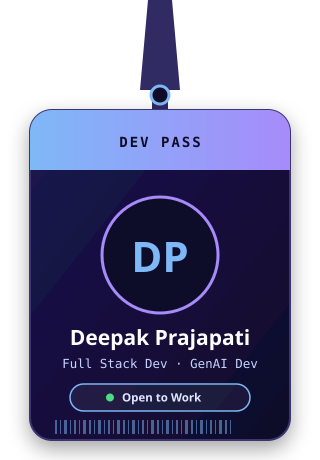
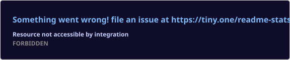

<!-- ═══════════════ HEADER ═══════════════ -->
<div align="center">


<br/><br/>


<br/><br/>

<a href="https://www.linkedin.com/in/deepak-prajapati-caged-coder/"></a>
<a href="https://deepak-macos-portfolio.vercel.app/"></a>
<a href="mailto:deepakprajapati8938@gmail.com"></a>
<a href="https://www.instagram.com/caged.coder/"></a>

</div>

<br/>

<!-- ═══════════════ ABOUT ═══════════════ -->
<table align="center" border="0">
<tr>
<td width="34%" align="center" valign="middle">



</td>
<td width="66%" valign="middle">

### 👨‍💻 About Me

```yaml
name     : Deepak Prajapati  (aka caged.coder)
role     : Full Stack & GenAI Developer
status   : Final-year B.Tech · Open to SDE / GenAI roles
focus    : Agentic AI · Scalable Systems · Microservices
learning : System Design · Advanced Backend · DSA
open_to  : Full-time · Internships · Open Source
motto    : "Good code solves the problem.
            Great code makes the next one easier."
```

</td>
</tr>
</table>

<br/>

<!-- ═══════════════ FEATURED ═══════════════ -->
<h2 align="center">🚀 Featured Projects</h2>

<table>
<tr>
<td colspan="2" width="100%">

#### 🖥️ [DeepakOS](https://github.com/deepakprajapati8938-del/Deepak-s-MacOS-Portfolio) &nbsp;·&nbsp; [`Live ↗`](https://deepak-macos-portfolio.vercel.app/)
Interactive macOS-style developer portfolio — fully custom, animated, responsive.<br/>
`React` `Tailwind CSS` `Framer Motion`

</td>
</tr>
<tr>
<td width="50%" valign="top">

#### 🤖 [ALOA](https://github.com/deepakprajapati8938-del/ALOA)
**Autonomous Laptop Operating Agent** — OS-layer agent for system automation, screen intelligence & multi-agent toolchains.

- OODA-loop architecture
- NetworkX knowledge-graph memory
- LLM fallback: Groq → Gemini → local Gemma
- Self-debugging Code Healer

`Next.js` `FastAPI` `Python` `llama.cpp` `Tesseract`

</td>
<td width="50%" valign="top">

#### 🎓 [Jules](https://github.com/deepakprajapati8938-del/Jules)
**NEET Prep PWA** — NCERT-grounded RAG study companion.

- Full RAG pipeline: embed → search → prompt → LLM
- AI-generated practice tests
- Reflective journaling + progress tracking

`React` `TypeScript` `FastAPI` `Supabase pgvector` `Gemini`

</td>
</tr>
<tr>
<td width="50%" valign="top">

#### 🗣️ [SQL Whisper](https://github.com/deepakprajapati8938-del/Sql-Whisper)
**Conversational SQL assistant** — natural language → accurate SQL.

- Auto schema discovery
- Sandboxed, read-only execution
- Error-aware self-correction retry loop

`FastAPI` `Streamlit` `Groq / Llama 3` `PostgreSQL`

</td>
<td width="50%" valign="top">

#### 🧾 [BillBrain AI](https://github.com/deepakprajapati8938-del/billbrain-ai)
**Smart invoice processor** — structured data extraction from invoices.

- Per-field confidence scoring
- Multi-language parsing & duplicate detection
- Property-based tests (Hypothesis)

`Python` `Streamlit` `Gemini` `pytest`

</td>
</tr>
<tr>
<td width="50%" valign="top">

#### 🎲 [Truth Roulette](https://github.com/deepakprajapati8938-del/TRUTH-ROULETTE)
**Real-time Truth/Dare party game** — casino UI, Hinglish AI content.

- Socket.io multiplayer rooms
- 45s reconnect grace window, instant resume
- Built for flaky mobile networks

`React` `Node.js` `Socket.io` `Groq / Llama 3.1`

</td>
<td width="50%" valign="top">

#### 🎯 [Placement Hub](https://github.com/deepakprajapati8938-del/Placement-Hub)
**Campus placement prep platform** — dashboards, tracking, leaderboards.

- Real-time XP leaderboard
- Role-based admin suite
- Materialized Postgres views for speed

`Next.js 15` `React 19` `Tailwind v4` `Supabase`

</td>
</tr>
</table>

<br/>

<!-- ═══════════════ MORE ═══════════════ -->
<details>
<summary><b>📂 More Projects</b></summary>
<br/>

| Project | Stack | Repo |
|:--|:--|:-:|
| 🌐 Internship Portal | `React` `Redux` `Node.js` `MongoDB` | [↗](https://github.com/Deepak12159/Internship-Portal) |
| 🐳 FlyRank Backend | `Node.js` `PostgreSQL` `Redis` `Docker` | [↗](https://github.com/deepakprajapati8938-del/FlyRank-Backend-API) |
| 🏗️ AI Microservices Platform | `Spring Boot` `RabbitMQ` `Docker` | [↗](https://github.com/Deepak12159/SpringBoot-AI-Microservices-main) |
| 📊 GitHub Profile Analyzer | `React` `TypeScript` `D3.js` | [↗](https://github.com/deepakprajapati8938-del/Github_profile_analyzer) |
| ✍️ Text-To-Handwriting | `TypeScript` `React` `Tailwind` | [↗](https://github.com/deepakprajapati8938-del/Text-To-Handwriting) |
| 📋 Smart Attendance Manager | `React` `JavaScript` `CSS` | [↗](https://github.com/deepakprajapati8938-del/Smart-Attendance-Manager) |
| 🧠 AI Plan Generator | `Python` `Flask` `TensorFlow` | [↗](https://github.com/Deepak12159/AI-PLAN) |

</details>

<br/>

<!-- ═══════════════ STACK ═══════════════ -->
<h2 align="center">🛠️ Tech Stack</h2>

<div align="center">

<br/>
<br/>


</div>

<br/>

<!-- ═══════════════ FOCUS ═══════════════ -->
<h2 align="center">🎯 Current Focus</h2>

<div align="center">

| 🤖 Agentic AI | 🏗️ Production Apps | 📐 System Design | 🧮 DSA | 🌍 Open Source |
|:-:|:-:|:-:|:-:|:-:|
| `Building` | `In Progress` | `Studying` | `Daily` | `Ongoing` |

</div>

<br/>

<!-- ═══════════════ STATS ═══════════════ -->
<h2 align="center">📊 GitHub Stats</h2>

<div align="center">




<br/>


<br/><br/>


<br/><br/>


</div>

<br/>

<!-- ═══════════════ FOOTER ═══════════════ -->
<div align="center">

*"Good code solves the problem. Great code makes the next problem* **easier to solve.***"*


</div>
